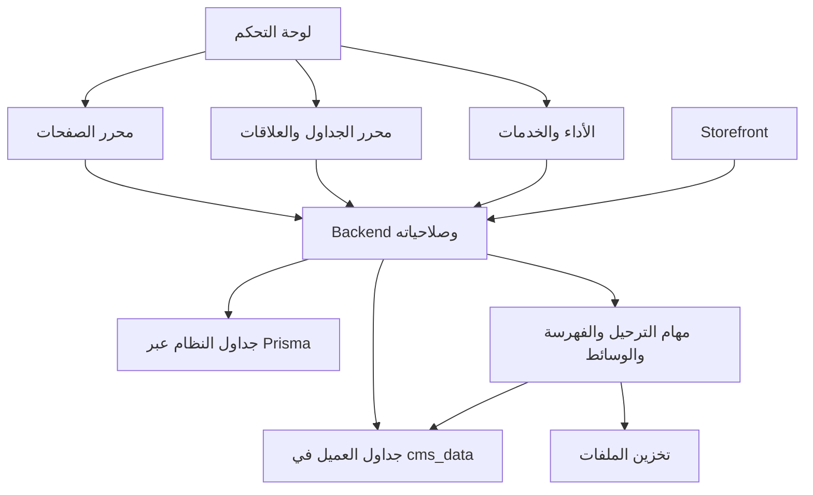

# خطة تطوير CMS والتحكم بالمتجر والبيانات

التاريخ: 7 نوفمبر 2026. الحالة: **المرحلة A نُفذت ونُشرت وتحقق وصولها للموقع. بقية المراحل خطة وليست ميزات مسلّمة**.

طلب المالك خطة شاملة أولًا قبل إضافة الميزات، ثم أجاز التنفيذ بقوله «نعم ابدأ». هذا المستند يحدد النتيجة المطلوبة ومراحل التنفيذ ومعايير قبولها. تفاصيل المرحلة الأولى وحدودها في `docs/cms-page-publishing.ar.md`؛ حالة كل مرحلة تُحدّث بعد التحقق منها.

## 1. الهدف وطريقة بيع المنتج

كل مشترٍ يملك نسخة مستقلة: Admin وStorefront وBackend وقاعدة PostgreSQL وملفات وإعدادات خاصة به. اسم المنتج الإداري منفصل عن اسم متجر العميل وتصميمه. تصميم استبرق الحالي يبقى تصميم متجر محدد؛ لا يصبح القالب الإجباري للزبائن.

النتيجة المقترحة تجمع ثلاثة أمور مترابطة:

1. محرّر لكل صفحات المتجر، مع نشر موثوق ومعاينة تطابق الصفحة العامة.
2. لوحة بيانات تتيح عرض الجداول، إنشاء جداول مخصصة وعلاقات وفهارس حقيقية، وربطها بالصفحات والنماذج.
3. إدارة تشغيل النسخة المستقلة: الأداء، الخدمات، الملفات، التحويل إلى SVG، التحديثات والنسخ الاحتياطية.

النجاح لا يقاس بعدد الأزرار أو القوالب: يجب أن يستطيع عميل إنشاء نموذج بيانات، ربطه بواجهة، اختبار التدفق ونشره ثم استعادته عند الحاجة، دون كسر الطلبات والدفع والهوية.

## 2. ما يوجد فعلًا في المشروع

هذه ملاحظات من قراءة الكود؛ لا تعني اختبار جميع هذه الأنظمة على حساب عميل جديد:

| المجال | الموجود | النقص الذي تعالجه الخطة |
|---|---|---|
| المحرّر | أشجار عناصر، مسودات، تاريخ وتراجع، معاينة حقيقية، ثيمات، SVG و3D وحركة، ومناطق تصميم مشتركة | صفحة اختيار موحدة لكل مسارات المتجر، وقوالب وظائف التجارة كعناصر قابلة للتنسيق |
| الصفحات | مسار CMS للصفحات المخصصة، واستبدال CMS للرئيسية وShop وCart وSearch وAbout وContact | الاستبدال لا يضمن وجود وظيفة السلة أو البحث داخل التصميم البديل؛ لا يوجد نظام موحد لكل الصفحات الديناميكية |
| قاعدة البيانات | PostgreSQL وPrisma، علاقات وفهارس محددة ضمن مخطط التطبيق | لا يوجد في المسارات والواجهات المفحوصة منشئ عام للجداول المخصصة وعلاقاتها وترحيلاتها |
| الأداء | مراقبة السيرفر وتجربة المتسوق، كاش وTTL، أولويات طلبات، وسجل إعدادات | توسيع التشخيص إلى الجداول المخصصة وربط الاقتراح بالتنفيذ والمتابعة |
| الفهارس | `indexAdvice.ts` يقرأ فهارس PostgreSQL وأحجام الجداول ويقترح فهارس للاستعلامات البطيئة | الصفحة الحالية للاقتراح؛ لا تنشئ الفهرس من اللوحة، ولا تدير دورة ترحيل كاملة |
| الوسائط | رفع ملفات وSVG آمن بمحرّر للألوان والأشكال | تحويل PNG/JPG/WebP إلى مسارات vector فعلية، مع معاينة وجودة وحدود تعقيد |
| التشغيل | صلاحيات، سجل نشاط، مهام ونسخ احتياطية وإعداد متجر | إدارة خدمات النسخة وتسليمها وتحديثها والتحقق من الاستعادة كدورة متكاملة |

المراجع المحلية الأساسية:

- `estabrek-admin/src/studio/StudioPage.tsx` و`src/features/pages/PagesListPage.tsx`.
- `estabrek-storefront/src/app/[lang]/shop/page.tsx` و`cart/page.tsx` و`src/cms/renderCmsPage.tsx`.
- `estabrek-store-backend/src/modules/admin/pages.controller.ts` و`src/modules/storefront/storefront.routes.ts`.
- `estabrek-store-backend/prisma/schema.prisma` و`src/lib/indexAdvice.ts`.
- `docs/independent-store-setup.md` و`docs/analytic-canvas-engine.ar.md`.

## 3. أولوية صفر: نشر الصفحة ومشكلة الصورة

زخارف SVG فوق وتحت من التعديل السابق تُحفظ في محتوى الصفحة وتستخدمها واجهة العرض العام أيضًا؛ ليست عرضًا داخل المحرّر فقط. ظهورها للزائر يتطلب أن تكون الصفحة نفسها منشورة ومتاحة على رابطها الصحيح.

الرابط الظاهر بالصورة `/t` يعرض رسالة Page not found. القراءة تكشف مسارًا يفسّر هذه النتيجة:

- `Page.status` يبدأ افتراضيًا بقيمة `DRAFT`.
- `POST /admin/pages/:id/draft/publish` ينقل محتوى المسودة إلى الصفحة وينظّف المسودة، لكنه لا يضبط `status` إلى `PUBLISHED`.
- زر المحرّر يعرض رسالة نجاح بأن التغييرات أصبحت في المتجر بعد هذا الطلب.
- API العام لا يعيد إلا صفحات `PUBLISHED` التي تسمح بها نافذة وقت النشر.

**المؤكد:** يوجد تعارض بين سلوك زر النشر وحالة الصفحة الجديدة. **غير المؤكد بعد:** هل سجل `/t` تحديدًا مسودة، أم مجدول، أم أرشيف، أم أن هناك مشكلة slug أو cache إضافية؛ لم تُقرأ بياناته الإدارية الخاصة ولم تُعدّل.

التصميم المقترح لدورة النشر:

1. فصل الحالات الظاهرة: مسودة محفوظة، منشورة، منشورة ولها تعديلات، مجدولة، منتهية، مؤرشفة.
2. «نشر الآن» يكتب المحتوى والحالة وتوقيت الإتاحة في عملية متسقة؛ الجدولة اختيار صريح مستقل ولا تُلغى مواعيد سابقة بصمت. نشر صفحة مؤرشفة يطلب اختيار إعادة نشرها بوضوح.
3. حفظ رقم مراجعة للمحتوى والحالة والجدولة ضمن فحص التعارض، حتى لا يُلغى قرار نشر أو أرشفة من جلسة أخرى.
4. استخدام صلاحية `pages:publish` على السيرفر، وحفظ مراجعة ونشاط لمن نشر ومتى.
5. توحيد slug والرابط النهائي واللغة؛ منع تعارض مسارات النظام، وإضافة redirect عند تغيير مسار منشور.
6. إبطال كاش الصفحات والقائمة واللغات، بما فيه نتيجة 404 السابقة، لكل Storefront مربوط فعليًا بالنسخة.
7. إظهار نتيجة منفصلة لحفظ النشر ووصول تحديث الكاش: فشل إعادة التحقق لا يُقدَّم على أنه فشل حفظ، ولا توصف الصفحة بأنها متاحة للعموم قبل فحص ذلك. إعادة المحاولة مهمة قابلة للتتبع.
8. زر «فحص الرابط العام» يعرض سبب عدم الظهور: مسودة، توقيت، رابط، وجهة نشر أو خطأ اتصال. لا يغيّر حالة الصفحة تلقائيًا.

القبول: صفحة جديدة على `/t`، وصفحة زارها أحد قبل نشرها فحصل على 404، تظهران بعد النشر في اللغات المفعّلة. المسودة والصفحة المؤرشفة والمجدولة للمستقبل لا تتسرب للعموم. يُختبر اختلاف المحتوى عن حالة النشر وتعارض جلسة أخرى وفشل تحديث أحد المتاجر.

## 4. تحرير جميع صفحات المتجر

### 4.1 سجل صفحات موحد

قائمة «صفحات المتجر» داخل المحرّر تعرض نوع الصفحة ومسارها وحالتها وقالبها واللغات وآخر ناشر. منها الانتقال بين الرئيسية، الصفحات الوظيفية، قوالب الصفحات الديناميكية، Header وFooter والصفحات الخاصة بالأخطاء.

| مجموعة | الصفحات المستهدفة | البيانات والسلوك المطلوب الحفاظ عليهما |
|---|---|---|
| تصفح | Home، Shop، Search، تصنيف `/c/[slug]` | فرز وفلترة وترقيم وصفحات ونتائج فارغة وفهارس بحث مناسبة |
| منتج | قالب `/p/[slug]`، وقالب مختلف اختياري لكل نوع منتج | السعر والمتغيرات والصور والمخزون والإضافة للسلة من خدمات التجارة الفعلية |
| شراء | Cart، تجربة إتمام الشراء الحالية، نجاح الدفع | تعديل الكمية والقسائم والشحن والتحقق من السعر والمخزون والدفع على السيرفر |
| عميل | Wishlist، Account، نماذج الدخول والحساب | جلسة العميل وصلاحياته؛ لا تُضمّن بياناته الخاصة داخل مستند CMS عام |
| طلب | `/order/[token]` وصفحات الطلب الحالية | فحص وصول العميل أو التوكن قبل قراءة بياناته؛ التوكن لا يصبح متغير CMS عامًا |
| محتوى | About، Contact، Policies، صفحات مخصصة ومتداخلة | الترجمة وSEO والنماذج والروابط |
| نظام | 404، الصيانة، عدم توفر الخدمة | حالة HTTP الصحيحة، وأولوية وصول صفحات الحساب والدفع |

لفظ «كل الصفحات» يشمل قوالب هذه المجموعات، وليس تحرير ملفات API أو كشف بيانات الحساب. تصميم صفحة المنتج يُطبّق كقالب مرتبط بالمنتج؛ لا ننشئ نسخة صفحة ثابتة لكل منتج.

### 4.2 عناصر تجارة قابلة للتحرير

نضيف كتلًا مثل Product listing وFilters وProduct details وVariant picker وAdd to cart وCart items وCart summary وCheckout form وSearch results وWishlist وAccount panel. تُقسّم إلى أجزاء عرض موثقة ومتاحة للتنسيق حسب الحاجة.

يمكن تعديل الحجم والتوزيع والألوان والنصوص والصور والحواف وSVG والحركة، وإضافة عناصر داخل الحاويات. يبقى منطق التسعير والمخزون والخصم والدفع مربوطًا بخدماته القائمة. فحص النشر يمنع قالب Cart بلا وظيفة سلة أو Checkout بلا خطوة إتمام شراء، ويشرح النقص داخل المحرّر.

نستفيد من استبدالات CMS الموجودة تدريجيًا بدل نقل كل المسارات دفعة واحدة. الصفحات غير المخصصة تبقى تعمل بسلوكها الحالي. المسارات الوظيفية لا تُحجز تلقائيًا لصفحة محتوى عادية بنفس الاسم.

### 4.3 شكل المعاينة

- نموذج منتج/تصنيف قابل للاختيار، وحالات Loading وEmpty وError وOut of stock، وسلة تجريبية معزولة.
- عرض Responsive للغات واتجاه RTL/LTR وحالات الحركة والتفاعل.
- تعديل العناصر يحدّث العرض داخل المستند نفسه؛ تغيير المسار أو هوية القالب قد يبدّل الإطار عند الحاجة.
- صفحات الحساب والطلبات تستخدم بيانات صناعية أو قراءة مصرحًا بها، ولا تولّد طلبًا أو دفعة حقيقية من المحرّر.
- اختبار القالب المنشور يتم عبر الرابط العام، لا عبر توكن المسودة.

القبول: يستطيع المصمم تعديل Shop وCart ونشرهما، وتبقى الفلترة وإضافة المنتج وتغيير الكمية والإجمالي وإتمام الطلب تعمل فعليًا. ثم ينجح نفس العقد للمنتج والتصنيف والحساب والبحث وباقي المجموعات.

## 5. المعمارية المقترحة لإدارة الجداول

هذه خيارات مقترحة، ولم يُختر أحدها باعتباره قرارًا وافق عليه المالك:

| الاختيار | الفائدة | الكلفة/الحدود |
|---|---|---|
| بيانات مرنة داخل جداول JSONB ثابتة | بداية أسرع ومرونة للحقول | أنواع وعلاقات وفهارس مخصصة أصعب، ولا يعطي جداول SQL مستقلة كما طلب المالك |
| توليد Prisma models وإعادة بناء السيرفر مع كل تغيير | أنواع معرفة وقت البناء | نشر وإعادة بناء لكل تعديل وربط مخطط العميل بإصدارات التطبيق |
| **جداول PostgreSQL مخصصة مع سجل تعريفات ومحرك ترحيلات** | جداول وعلاقات وفهارس حقيقية دون إعادة بناء لكل جدول | يحتاج محرك صلاحيات واستعلامات وترحيلات مضبوطًا |

**التوصية المقترحة:** الاختيار الثالث داخل النسخة المستقلة، مع إبقاء جداول النظام تحت Prisma. هذا الفصل يحافظ على ترقيات المتجر ويحقق طلب إنشاء جداول فعلية من اللوحة.

هذا المخطط لنسخة عميل واحدة. لا توجد قاعدة مشتركة تجمع متاجر الزبائن، ولا لوحة مالك متجر تستطيع دخول نسخة عميل آخر.

### 5.1 جداول النظام والجداول المخصصة

- عرض بنية جداول النظام وعلاقاتها وفهارسها. بياناتها تبقى خاضعة لصلاحيات وحدات المنتجات والعملاء والطلبات الحالية؛ لا يمنح Database Explorer وصولًا إضافيًا إليها.
- إنشاء الجداول المخصصة في schema مستقل مقترح اسمه `cms_data`؛ أسماء SQL الداخلية تولّدها المنظومة ولا تتغير بتعديل الاسم المعروض.
- وصف الحقول والواجهات والصلاحيات والعلاقات والفهارس في سجل تعريفات بإصدارات، تديره ترحيلات التطبيق المعتادة.
- استخدام Prisma لخدمات التجارة والسجلات الثابتة، ومحرك استعلامات ديناميكي مضبوط للجداول المخصصة. لا نشغّل `prisma db push` ولا نعيد توليد Prisma Client من مدخلات المستخدم وقت التشغيل.
- روابط من جدول مخصص إلى منتج أو تصنيف ممكنة عبر أهداف معتمدة؛ حذف منتج مرتبط يحتاج سياسة معلنة. افتراضيًا لا يسمح مخطط العميل بأن يحذف صفوف النظام تلقائيًا.
- حذف العميل أو إخفاء المنتج عبر خدمات النظام يعالج الروابط المعتمدة وفق سياسة الاحتفاظ؛ لا نضيف FK يعرقل التدفق الحالي دون تعديل عقده واختباره.

### 5.2 واجهة الجداول

Tabs مقترحة لكل جدول: **البيانات، الحقول، العلاقات، الفهارس، الصلاحيات، السجل**. ومخطط علاقات ERD للتنقل بين الجداول وإنشاء علاقة بالسحب ثم ضبط معناها.

حقول أولية: نص قصير/طويل، رقم صحيح، Decimal بدقة محددة، مبلغ مع عملة، Boolean، تاريخ ووقت، اختيار، JSON مقيد، رابط ملف، ورابط سجل. الحقل متعدد اللغات يحتاج نوعًا واضحًا وليس نسخ أعمدة عشوائية.

خصائص الحقل: Required، Unique، Default، حدود وقواعد تحقق، اسم داخلي واسم معروض مترجم، إخفاء أو قراءة فقط، وفهرسة عند الحاجة. حقول الحساب المشتقة تبدأ بتعبيرات محدودة معروفة؛ JavaScript وSQL الحر ليسا نوع حقل افتراضيًا.

محرر البيانات يدعم تصفحًا على دفعات، بحثًا وفرزًا وفلترة، أعمدة محفوظة، عمليات جماعية محدودة، واستيراد CSV مع معاينة أخطاء واستيراد قابل للاستئناف. تصدير البيانات يحترم صلاحيات الحقول والصفوف ولا يصدر أعمدة مخفية في الخلفية.

## 6. العلاقات الأربع وكيف تُنفّذ

| العلاقة في اللوحة | مثال | التمثيل المقترح في PostgreSQL |
|---|---|---|
| One to many | Brand له منتجات كثيرة | Foreign key على صفوف الجانب المتعدد، مع فهرس مناسب لقراءة هذه الصفوف |
| Many to one | منتجات كثيرة تابعة لـBrand | الجهة المعاكسة للعلاقة السابقة، وليست علاقة SQL إضافية |
| Many to many | منتجات كثيرة لها Tags كثيرة | جدول وسيط يحتوي مفتاحَي الطرفين وقيد Unique عليهما، وفهرسة الاتجاه العكسي حسب الاستعمال |
| One to one | Warranty details لسجل منتج | Foreign key مع Unique؛ يحدد Required إن كان الربط إلزاميًا |

لكل علاقة نحدد: الطرف المالك للمفتاح، وأسماء جهتي العرض، هل الرابط اختياري، وسياسة حذف وتعديل السجل المرجعي. الخيارات RESTRICT/NO ACTION وSET NULL وCASCADE تعرض مع أثرها؛ SET NULL يتطلب حقلًا يسمح بالقيمة الفارغة. العلاقات مع جداول النظام تمر بعقود معتمدة وتستبعد حذف النظام عبر CASCADE من مخطط مخصص.

قبل إضافة العلاقة نفحص السجلات اليتيمة والتكرارات وتوافق أنواع المفاتيح. العلاقة One to one بعمود nullable تسمح افتراضيًا بعدة صفوف غير مرتبطة؛ Unique يمنع تكرار الرابط نفسه، ولا يفرض وجود رابط لكل صف.

جدول وسيط لا يضاف مرتين عند فتح نفس العلاقة من الجهة الأخرى. تغيير Many to many إلى One to many يتطلب بيان السجلات التي لها أكثر من رابط وخطة معالجة معلنة.

تُفرض القيود في قاعدة البيانات، وتُطبق صلاحية قراءة الطرف المرتبط في API؛ صلاحية قراءة الجدول الأول وحدها لا تكفي لعرض بيانات الجدول الثاني. هذه القواعد تتبع [قيود PostgreSQL](https://www.postgresql.org/docs/current/ddl-constraints.html).

## 7. الفهارس والتحسين

### 7.1 مدير الفهارس

نعم، الخطة تشمل إنشاء وإدارة Index من اللوحة. الترتيب المقترح:

**حدود التنفيذ المقترحة:** إنشاء وحذف الفهارس من مدير الجداول في هذه الخطة يخص جداول `cms_data`. فهارس جداول النظام `public` تظهر للقراءة والاقتراح كما في النظام الحالي، لكن تعديلها يمرّ عبر ترحيل إصدار التطبيق ومراجعته؛ لا يملك عامل الجداول المخصصة صلاحية تعديل فهارس core. تُسجّل الاقتراحات المقبولة كمهام تحسين مرتبطة بالإصدار الذي ينفذها. إدارة فهارس core مباشرة وقت التشغيل تحتاج تصميم امتيازات وتوافق ترقيات مستقلًا، وليست ضمن هذه الدفعة المقترحة.

1. فهارس B-tree عادية ومركبة، واتجاه الفرز وترتيب الأعمدة، وUnique.
2. فهارس جزئية بقواعد مسموحة، وفهارس بحث GIN عند اختيار نوع بحث مناسب.
3. فهارس تعبيرية وINCLUDE وامتدادات البحث لاحقًا بعد فحص إصدار PostgreSQL وقدرات المزود.

تُعرض قائمة الفهارس وحجمها وتعريفها وحالتها والقيد الذي يحميه كل فهرس. PK وUnique ينشئان فهرسًا تلقائيًا في PostgreSQL، بينما Foreign key لا ينشئ تلقائيًا فهرسًا على جانب الإشارة؛ نتفادى التكرار ونختار الفهرس المناسب بدل إضافة فهرس أعمى لكل عمود. [مرجع القيود والفهارس](https://www.postgresql.org/docs/current/ddl-constraints.html).

إنشاء الفهرس على جدول كبير مهمة بخلفية التنفيذ، تستخدم `CONCURRENTLY` عندما يكون ذلك مناسبًا ومدعومًا. لا توضع هذه العملية داخل transaction عادية، وتُسلسل العمليات على الجدول وتُرصد الأقفال والمهلة والفهارس غير الصالحة عند الفشل. لا ندّعي أن الفهرسة خالية من أي قفل أو كلفة. [مرجع CREATE INDEX](https://www.postgresql.org/docs/current/sql-createindex.html).

### 7.2 تحسينات مبنية على القياس

نوسّع صفحة السرعة الموجودة لتعرض الاستعلامات المكلفة، التكرار، عدد الصفوف التقريبي، زمن API وDB ونسب cache hit وتجربة المستخدم وازدحام pool. مصادر القياس الموجودة أولًا؛ `pg_stat_statements` اختياري وفق توافر المزود وصلاحياته.

اقتراح الفهرس يوضح الاستعلام المستهدف، سبب الاختيار، كلفة التخزين والكتابة المتوقعة وحدود الثقة. بعد التنفيذ نقارن عينات مماثلة قبل/بعد؛ لا نعد بنسبة تسريع ثابتة.

فحص `EXPLAIN` الافتراضي للاستعلامات المولدة والمقيدة يعرض الخطة المقدرة. `EXPLAIN ANALYZE` يشغّل الاستعلام فعلًا، لذلك فحصه التفصيلي يُستخدم على نسخة اختبار معزولة وبميزانية وقت، وليس على عمليات تعديل من لوحة عامة. [مرجع EXPLAIN](https://www.postgresql.org/docs/current/using-explain.html).

يشمل التحسين كذلك تجنّب N+1، اختيار الأعمدة المطلوبة، pagination مناسبًا للبيانات الكبيرة، حدًا لعمق العلاقات وعدد نتائجها وكلفة الاستعلام، ضبط pool وفق سعة قاعدة العميل، وتحميل الصور والموديلات والحركة عند الحاجة. الفهارس المقترحة لا تُضاف كلها تلقائيًا، ولا تُحذف فهارس الحماية أو الفهارس قليلة الاستخدام بناءً على فترة قصيرة فقط.

## 8. إدارة التغييرات والترحيلات

كل تعديل هيكل له مسودة تعريفات ثم خطة تغيير وإصدار ورقم عملية ونتيجة قابلة للمراجعة:

`تعريف مقترح → فحص بيانات → خطة SQL مقيدة → اختبار معزول → تطبيق → تحقق → إصدار منشور`

- سجل وظائف دائم مع idempotency، وقفل على النموذج أثناء الترحيل، واستئناف بعد انقطاع السيرفر.
- تمييز عمليات آمنة نسبيًا، مثل إضافة عمود اختياري، عن تحويل أنواع أو فرض Required أو حذف عمود له بيانات.
- أي تحويل بيانات يحتاج backfill على دفعات، ثم فحص القيود، ثم التحويل التدريجي لاستخدام الحقل الجديد.
- عدم تزامن DDL مع تحديث metadata بصمت: لكل مرحلة حالة موثقة وخطوة استكمال، ونشر تعريف النموذج بعد نجاح المخطط الفعلي. فحص drift يكشف اختلاف قاعدة البيانات عن التعريف المحفوظ.
- أرشفة وإخفاء قبل الحذف النهائي، وإظهار اعتماد الصفحات والنماذج والعلاقات والفهارس على الحقل أو الجدول.
- لا نعد بتراجع سحري بعد حذف البيانات. التراجع في تغيير قابل للعكس يختلف عن الاستعادة من backup، والاستعادة قد تفقد كتابات أحدث من وقت النسخة ما لم تتوفر آلية استعادة أدق.
- نسخة احتياطية للقاعدة **والملفات والتعريفات**، مع اختبار استرجاع فعلي إلى بيئة مستقلة وقياس زمنه. النسخة المشفرة ليست سليمة لمجرد رفع ملفها.
- ترقيات التطبيق تشمل جداول النظام وسجل metadata، وتحافظ على schema المخصص ولا تشغّل reset أو introspection يكتب فوق تعريفات العميل.

## 9. ربط الجداول بالصفحات والنماذج

يحدد المصمم للعنصر مصدر بيانات من قائمة مسموحة: منتجات، تصنيفات، أو جدول مخصص منشور. ثم يختار الحقول والفلتر والفرز والتقسيم والعلاقات المصرّح بها.

مكوّنات مقترحة: Data repeater، سجل مفرد، جدول عرض، بطاقات، قائمة اختيار من جدول، نموذج إنشاء أو تحديث، وإظهار مشروط بقيمة حقل. صفحة ديناميكية مثل `/brands/[slug]` تستخدم قالبًا واحدًا ومصدر بيانات، مع قواعد SEO و404 وslug فريد.

API المخصص يولّد CRUD عبر وسيط مصادقة وصلاحيات وتحقق موحد، ولا يحوّل كل جدول إلى endpoint عام تلقائيًا. إعدادات القراءة العامة منفصلة عن القراءة الإدارية والكتابة؛ الحسابات الخاصة تستخدم استعلامات session-scoped.

استعلامات العلاقات محدودة العمق والصفوف، والعمليات الجماعية لها سقوف ووقت أقصى، والملفات ترتبط بمراجع أصول معروفة. تغيير البيانات يُبطل الكاش للصفحات المعتمدة، وتغيير الهيكل يفحص صلاحية الروابط قبل النشر.

## 10. تحويل الصور إلى SVG

مكان الميزة المقترح: مكتبة الوسائط، وإعدادات عنصر الصورة داخل المحرّر، وزر داخل محرّر SVG لاختيار صورة كمصدر.

التدفق: اختيار PNG/JPG/WebP → Preset للشعار/الأيقونة/الرسم/الصورة → ضبط الألوان والتفاصيل والتنعيم والخلفية → معاينة الأصل والنتيجة → حفظ أصل جديد أو إدراج SVG أو تنزيله.

النتيجة المطلوبة **مسارات vector قابلة للتحرير**، وليست `<image>` أو Base64 لصورة داخل ملف SVG. الصور الفوتوغرافية قد تحتاج تبسيطًا وتفقد تفاصيل أو تنتج ملفًا أكبر؛ يُحفظ الأصل وتُعرض المقارنة والحجم وعدد الأشكال قبل الاعتماد.

مرشح تقني أول للفحص: VTracer، الذي يوفّر تحويلًا ملونًا وبناء Node/WASM حسب [توثيقه الرسمي](https://github.com/visioncortex/vtracer/blob/master/nodejs/README.md). هذا ترشيح يحتاج spike للترخيص والحزمة والجودة والأداء، وليس dependency اختيرت أو ثُبتت بالفعل. التنفيذ المقترح في worker معزول عن API الطلبات، مع تقدم وإلغاء ومهلة وحدود ذاكرة وحجم وصيغ تُفحص فعليًا بعد فك الترميز. بدء التحويل لا يرفع الصورة إلى خدمة خارجية تلقائيًا.

يُمرر الناتج عبر منظف SVG الموجود ثم فحصه في السيرفر. الحدود الحالية مهمة: 600 شكل، عمق 10، path حتى 20000 حرف، وملف المستورد حتى 400000 بايت. إذا تجاوز الناتج الحدود نعيد التبسيط أو نطلب خفض التفاصيل؛ لا نحذف مسارات بصمت ونحفظ رسمة ناقصة. اختبار النتيجة يشمل النسبة والألوان والشفافية والأنماط المرفوضة والتحجيم الحالي والتراجع.

## 11. التحكم في Backend والخدمات

نقترح توسيع صفحات النظام الحالية بدل إنشاء لوحة ثانية منفصلة:

- مركز خدمات: API، PostgreSQL، Redis، التخزين، البريد، الدومين وCDN، مع الحالة وآخر فحص والنسخة وحدود الاستخدام المتاحة.
- إعدادات اتصال حساسة تُحفظ أو تُدار كأسرار على السيرفر وتظهر مقنّعة؛ لا تُرجع API القيم السرية للمتصفح عند عرضها. تغيير عنوان قاعدة البيانات عملية نقل وفحص بيانات، وليس تعديل input ثم إعادة تشغيل فقط.
- Jobs: نشاط المهمة، retry وحدوده، وقت البداية، الإلغاء عندما تدعمه العملية، وسجل واضح يمنع تكرار طلب أو دفعة. يستفيد من نظام المهام القائم.
- صلاحيات منفصلة للبيانات وتصميم الصفحات وتغيير الهيكل والفهرسة والخدمات والنسخ الاحتياطية، مع سجل تدقيق.
- API tokens محدودة النطاق والعمر، وإدارة webhooks بالتوقيع وإعادة المحاولة ومنع التكرار، على أساس القدرات القائمة.
- Dev/Staging/Production: تعريفات وقوالب قابلة للنقل مع فحص الاعتمادات؛ لا ننقل بيانات العملاء الخاصة إلى المعاينة تلقائيًا.
- إعداد نسخة العميل يمكن أن يربط Railway أو مزود سيرفر آخر، وNeon أو PostgreSQL آخر، وVercel أو استضافة أخرى، وRedis وCloudflare وCloudinary اختياريًا. قدرات كل connector وملكية حسابه وصلاحياته تُراجع في وثائق المزود عند التنفيذ؛ بعض الإجراءات قد تحتاج خطوات يدوية في حساب العميل.
- مسار ترقية نسخة مستقلة: فحص توافق، backup، ترحيلات، نشر، smoke tests، ثم متابعة. لا يشترط وجود لوحة مركزية تتحكم بكل قواعد بيانات العملاء.

API تشغيل البيانات لا يستخدم دور قاعدة بيانات يملك DDL. مهام الهيكل تستخدم دورًا مخصصًا بصلاحية أقل ما يلزم داخل schema المخصص، ومع REFERENCES محدود للأعمدة المرجعية المعتمدة في جداول النظام عند السماح بعلاقة معها، دون امتلاك ALTER أو حذف بيانات core أو إدارة فهارسه. ترحيلات إصدار التطبيق لها مسار صلاحيات منفصل. إن كانت البيئة تدعم عزلًا مختلفًا يوثق ذلك. القيم تُمرّر بمعاملات، وأسماء الجداول والحقول تأتي من سجل موثوق مع اقتباس صحيح، ولا تدخل أسماء المستخدم مباشرة في SQL.

## 12. تحسينات إضافية للمنتج

| الإضافة | فائدتها | ارتباطها بالخطة |
|---|---|---|
| حزم مجال متكاملة | حقول وتدفقات للملابس، الإلكترونيات، الطعام، الخدمات | التصميم مع نماذج البيانات والقدرات الفعلية؛ حجوزات أو اشتراكات تحتاج محركات أعمال إضافية |
| مكتبة Components وقوالب وظيفية | حفظ Cart summary أو بطاقة منتج أو قسم بيانات وإعادة استعماله | إصدارات واضحة وروابط قابلة للتحديث مع معاينة أثر التغيير |
| محرّر Automations | عند إضافة سجل، إرسال بريد أو استدعاء webhook أو تشغيل مهمة | يبني على المهام والأتمتة الحالية، مع صلاحيات وحدود وإعادة محاولة |
| فحص قبل النشر | كشف رابط مكسور، بيانات غير مربوطة، alt مفقود، تباين ضعيف أو نموذج ناقص | تقرير قابل للإصلاح داخل المحرّر، مع ميزانية للحركة و3D والموبايل |
| سجل موحد | معرفة من غيّر حقلًا أو علاقة أو ثيمًا أو إعداد سيرفر | فرق قبل/بعد ومراجعات، مع حجب الأسرار والقيم الحساسة |
| مركز بحث وأوامر | الوصول لصفحة أو جدول أو ملف أو مهمة بسرعة | يحترم صلاحية كل مستخدم ولا يكشف أسماء موارد محجوبة |
| تصدير حزمة متجر | نقل التصميم والتعريفات والملفات والمحتوى إلى نسخة مستقلة | فحص الإصدارات والاعتمادات قبل الاستيراد، والأسرار خارج الحزمة العادية |
| حزم إضافات موثقة | توسيع المنتج بدون تعديل core لكل عميل | عقد API وإصدارات وصلاحيات واختبار توافق وعزل للكود غير الموثوق |

## 13. ترتيب التنفيذ المقترح ومعايير التسليم

هذا ترتيب تقني مقترح، وليس وعدًا زمنيًا. تُقدَّر مدة كل مرحلة بعد تثبيت تفاصيلها وspike للمجهول.

| المرحلة | التسليم المحدد | الاعتماد | علامة الاكتمال |
|---|---|---|---|
| A | إصلاح دورة النشر والرابط العام والتشخيص والكاش | لا شيء جديد | حالات DRAFT/Published/Scheduled/Archived وتعارض الجلسات و404 السابقة تعمل |
| B | سجل صفحات موحد وShop وCart كقوالب وظائف قابلة للتحرير | A | نشر تصميم جديد مع نجاح رحلة فلترة → منتج → سلة → طلب على بيانات اختبار |
| C | Product/Category/Search/Wishlist/Account/Order/Policies/System templates | B | مصفوفة مسارات ولغات وحالات وصلاحيات؛ نفس سلوك التجارة والحساب الحالي |
| D | تحويل صورة إلى SVG في الوسائط والمحرّر | مستقلة عن B/C بعد تثبيت عقد الوسائط | ناتج paths حقيقي داخل الحدود، preview/cancel، وقياس جودة وحجم لعينات متنوعة |
| E | Database Explorer قراءة، مع ERD وبيانات وفهارس وصلاحيات | مراجعة الأدوار الحالية | يرى المستخدم ما تسمح به صلاحياته فقط، وتبقى الأسرار وبيانات الحساب محمية |
| F | جداول وحقول مخصصة ومحرك metadata وترحيلات واستعادة | E وقرار المعمارية | جدول SQL حقيقي ينشأ ويُحفظ بعد إعادة تشغيل السيرفر، مع فحص drift واستعادة |
| G | العلاقات الأربع ومدير فهارس الجداول المخصصة، واقتراحات فهارس النظام | F | قيود فعلية، رفض orphan/duplicates، مهمة فهرسة قابلة للتتبع وفشل قابل للاستكمال؛ تغييرات فهارس core عبر ترحيل التطبيق |
| H | Data binding والنماذج والصفحات الديناميكية | B/F/G | بيانات جدول وعلاقاته تظهر وتُحدّث عبر واجهة منشورة بصلاحيات صحيحة |
| I | تحسينات الأداء والتشغيل وتكامل خدمات النسخة | E/F/G والقياس القائم | تقرير قبل/بعد، ضغط متزامن، ترقية واستعادة على نسخة عميل مستقلة |
| J | حزم المجالات والإضافات والأتمتة والمكتبات | العقود المستقرة للمراحل السابقة | حزمة تستورد وتصدّر دون الاعتماد على قالب المصدر أو بيانات متجر آخر |

يمكن تنفيذ D في مسار مستقل، بينما B/C لا تنتظران بناء محرّر قواعد البيانات. البدء بـA ثم B يمنح قيمة مباشرة ويزيل الخلل الظاهر قبل زيادة نطاق النظام.

## 14. الاختبارات المطلوبة عند التنفيذ

- دورة HTTP فعلية محلية لإنشاء صفحة وحفظها ونشرها ثم قراءتها من مسارها العام. تضمين التوقيت واللغة والصلاحية وفشل إعادة التحقق.
- اختبارات متصفح للمحرّر والصفحات المنشورة، وتطابق المعاينة مع حفظ 2D/3D وSVG والحركة والتراجع.
- PostgreSQL اختبارية حقيقية لعلاقات FK وUnique والجداول المخصصة والترحيلات؛ mocks وحدها لا تثبت صحة DDL أو الأقفال.
- اختبار طلب متزامن وتعديل هيكل وفهرسة واستئناف بعد انقطاع worker، ومنع تنفيذ نفس المهمة مرتين.
- اختبارات وصول سلبية: مستخدم لا يقرأ جدولًا مرتبطًا، عميل لا يقرأ طلب عميل آخر، وتصدير لا يكشف حقولًا محجوبة.
- ميزانية أداء تُحدد بقياسات المرحلة الأولى: عدد السجلات، تزامن الاستعمال، p95، حجم الملف ومساحة العمل. لا يُختار هدف عشوائي بلا baseline.
- استعادة إلى بيئة مستقلة ثم تشغيل السيناريوهات الأساسية، وتحقق أن ترقية core لا تكسر الجداول المخصصة.
- التشغيل على fixtures وبيئة اختبار معزولة؛ لا تُنشأ طلبات أو دفعات أو جداول تجريبية في متجر منشور.
- معالجة تشخيصات TypeScript القديمة للوحة قبل اعتماد فحصها الكامل كشرط إصدار، مع استمرار شرط عدم إدخال أخطاء جديدة أثناء الانتقال.

## 15. قرارات المقترح وحدود الموافقة

المؤكد من المالك: نسخة مستقلة لكل عميل؛ تحرير صفحات المتجر؛ جداول وعلاقات وفهارس وتحسين؛ تحويل الصور إلى SVG؛ والخطة أولًا قبل إضافة الميزات.

المقترح مني: PostgreSQL schema مخصص مع metadata، فصل جداول النظام عن تعديل الهيكل الحر، قوالب تجارة تحتفظ بمنطق الأعمال، وترتيب A→B قبل توسيع البيانات. اختيار محرك التحويل وأسماء API الداخلية وتفاصيل الواجهة والإصدارات يثبت عند تخطيط كل مرحلة، ولا ينسب للمالك كقرار وافق عليه.

لا يصرح هذا المستند بحذف جداول قائمة، ولا بإجراء ترحيلات على قاعدة عميل، ولا بتبديل مزودي الاستضافة أو دفع رسومهم. تكلفة الخدمات وحجم البيانات وميزانية الأداء وصلاحيات مزود العميل تُحدد قبل المرحلة المرتبطة بها.

المستند يعطي خطة مراجعة شاملة. عند اختيار بدء التنفيذ، تُحوّل المرحلة المختارة إلى مهام صغيرة بمسارات الكود واختبارات قبول ثم تنفذ وتراجع وتنشر وفق صلاحيات الجلسة.
